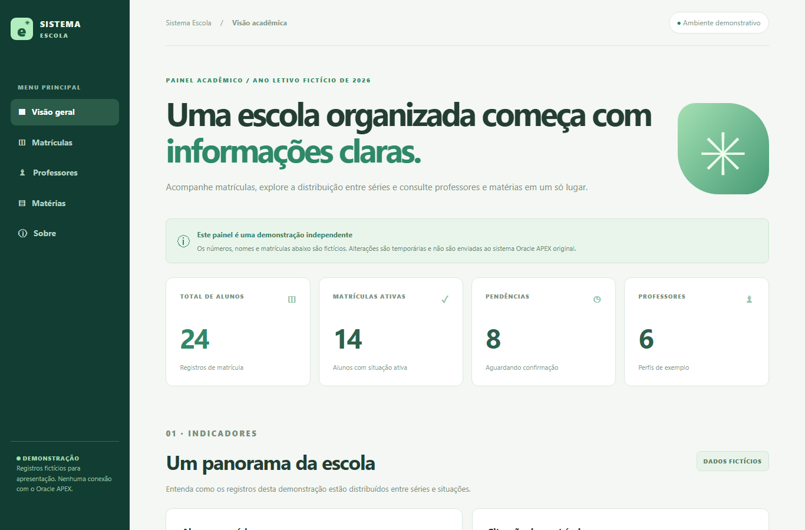
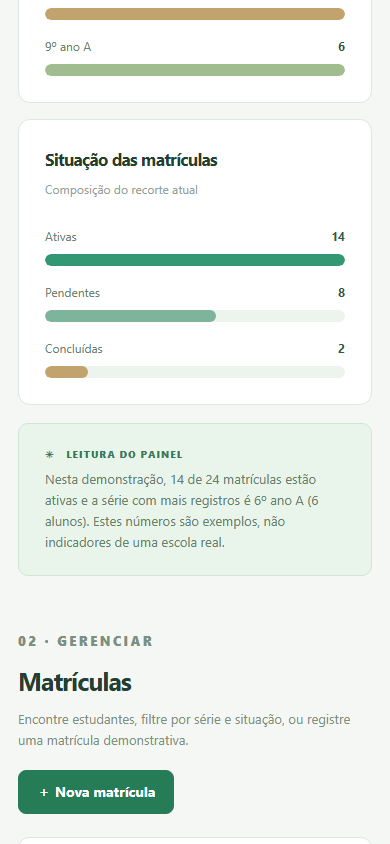

# Sistema Escola — Gestão Acadêmica

**Aplicação para organização de professores, matérias, alunos e séries escolares**, desenvolvida originalmente com Oracle APEX. O repositório também oferece uma demonstração web interativa para explorar o conceito de gestão acadêmica sem depender de uma conta Oracle.

## Interface

| Visão acadêmica | Versão para celular |
| --- | --- |
|  |  |

A demonstração utiliza **dados inteiramente fictícios**, identificados na própria interface.

## Funcionalidades

A exportação da aplicação Oracle APEX inclui páginas para **professores, matérias, alunos/matrículas e séries**, com formulários e relatórios interativos.

Na demonstração web, você pode:

- **Acompanhar matrículas:** visualizar totais, matrículas ativas e pendências.
- **Explorar indicadores:** consultar gráficos de distribuição por série e por situação.
- **Pesquisar alunos:** filtrar registros por nome, código, série e situação.
- **Simular cadastros:** adicionar uma matrícula fictícia e alterar sua situação.
- **Exportar CSV:** baixar o recorte atual de matrículas da demonstração.
- **Consultar professores e matérias:** visualizar a equipe e a organização curricular ilustrativas.

As mudanças realizadas na demonstração ficam **somente na memória do navegador**. Ao recarregar a página, os exemplos originais são restaurados.

## Executar a demonstração

**Requisito:** Python 3, usado apenas para iniciar um servidor HTTP local.

```bash
git clone https://github.com/JackNoArms/Projeto_Escola.git
cd Projeto_Escola
python -m http.server 8000
```

Abra **http://localhost:8000/demo/**.

Não é necessário instalar dependências JavaScript, criar contas nem conectar um banco de dados.

## Aplicação Oracle APEX

O arquivo `f193381.sql` contém a exportação original do **Sistema Escola** no formato Oracle APEX 22.2. A pasta `readable/` organiza seus componentes em arquivos legíveis, incluindo páginas, formulários e componentes compartilhados.

Para executar essa versão, é necessário um **workspace Oracle APEX autorizado**, com esquema e dependências apropriados. A importação e a execução da aplicação Oracle não são necessárias para experimentar a demonstração web.

## Tecnologias

| Tecnologia | Papel |
| --- | --- |
| **Oracle APEX** | Aplicação original e relatórios interativos |
| **SQL / PL/SQL** | Objetos e lógica da aplicação Oracle |
| **HTML, CSS e JavaScript** | Demonstração web responsiva |
| **Node.js Test Runner** | Testes das regras e dados demonstrativos |

## Estrutura

```text
f193381.sql      Exportação original do Oracle APEX
readable/        Componentes legíveis da aplicação original
demo/            Dashboard e matrículas fictícias no navegador
tests/           Testes da demonstração
docs/            Imagens da interface
```

## Testes

Com Node.js 20 ou superior:

```bash
node --test tests/demo.test.mjs
```

A demonstração é independente da aplicação Oracle; os testes cobrem os dados fictícios, os filtros, os indicadores e as ações simuladas de matrícula.

*Sistema Escola é um projeto de estudo de gestão acadêmica. Os exemplos não representam dados reais de estudantes ou instituições.*
